# Pablo Banzo Prida

Software engineer building AI agents and the platforms they run on.

- 🚚 **Now:** Founding Engineer at [Delphi Logistics](https://godelphi.ai), building AI agents for logistics.
- 🎙️ **Before:** At Tangering AI, I built the MCP tool integrations used by live voice agents, co-owned the Supabase/Postgres database layer, and was one of the top contributors to the voice-agent runtime, on a platform that handled 3M+ calls.
- ⚖️ **Earlier:** Co-founded [Reli](https://www.linkedin.com/company/reliai), an AI legal research platform built on 100,000+ Mexican laws and regulations.
- 🐐 **Also:** Co-founder & Tech Lead of goatpass, a social sports-picks app I built from the ground up. It reached 1,000+ users and #12 in Sports on Mexico's App Store.
- 🎓 B.S. in Computer Science and Technology, Tecnológico de Monterrey (Summa Cum Laude).

**Stack:** Python · TypeScript · PostgreSQL · LLM agents · MCP · AWS

[banzo.dev](https://banzo.dev) · [LinkedIn](https://www.linkedin.com/in/pridapablo/)

